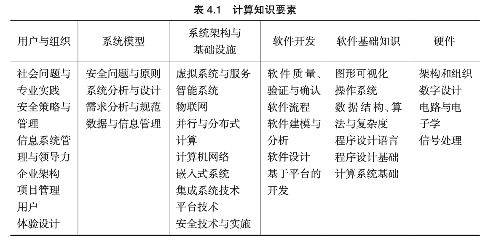
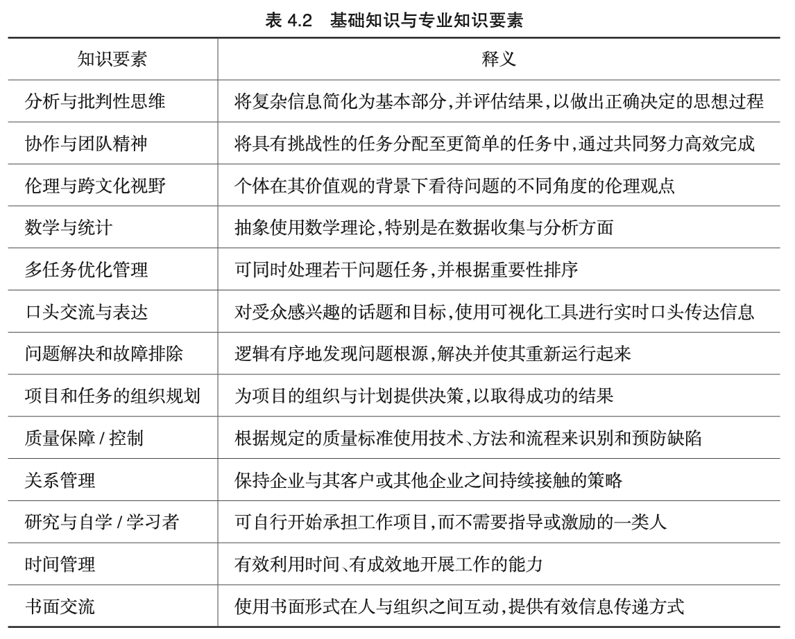
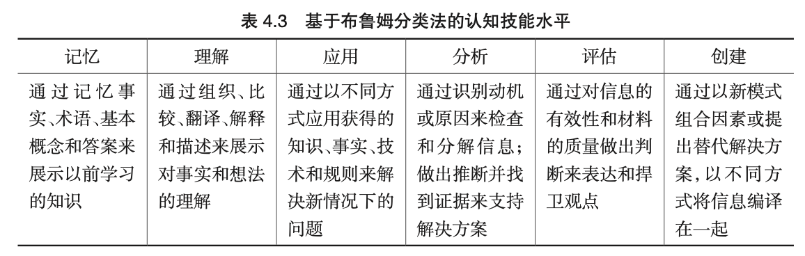
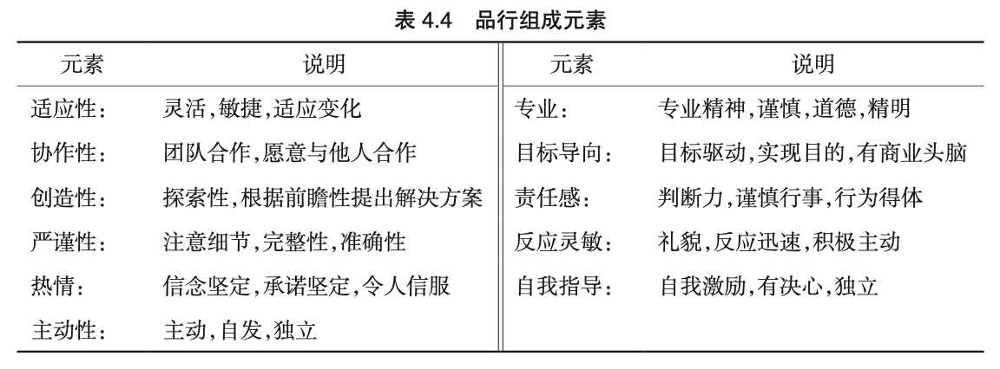
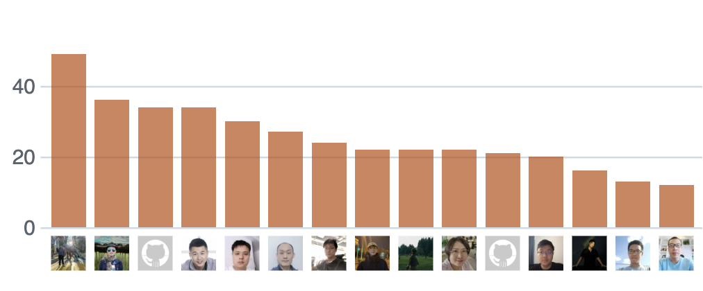
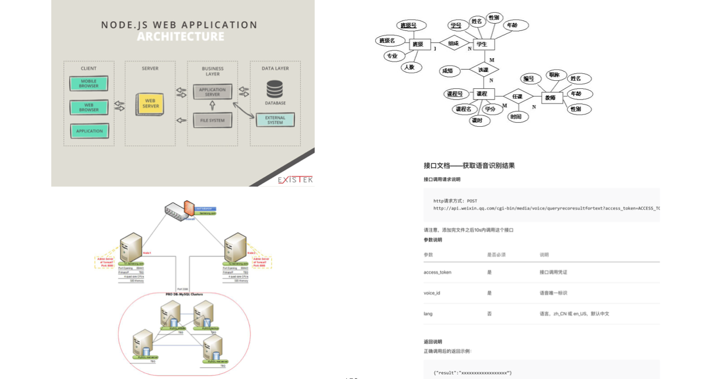

# 时间：15分钟
# 学习目标
* 1.	掌握产品设计和开发的知识和方法；
* 2.	熟悉项目管理知识体系以及项目管理的基本方法；
* 3.	掌握项目管理中沟通管理和风险管理的主要内容、分析工具；
* 4.	熟悉敏捷开发的职能分配、具体活动和产出成果；
* 5.	应用敏捷开发方法完成一次软件开发迭代活动；
* 6.	掌握软件开发的设计、编码和测试流程，利用软件开发工具如IDE（包括质量检查相关插件工具）、团队协作工具（git/github）和知识技能完成软件作品；
* 7.	掌握软件开发中获取工具和知识、建立自己知识库的基本方法；
参考以下内容
 https://github.com/bettermorn/ACMWDevHubPPT/blob/master/UploadImg/%E8%A1%A84.1%E8%AE%A1%E7%AE%97%E7%9F%A5%E8%AF%86%E8%A6%81%E7%B4%A0.png

https://github.com/bettermorn/ACMWDevHubPPT/blob/master/UploadImg/%E8%A1%A8%204.2%20%E5%9F%BA%E7%A1%80%E7%9F%A5%E8%AF%86%E5%92%8C%E4%B8%93%E4%B8%9A%E7%9F%A5%E8%AF%86%E8%A6%81%E7%B4%A0.png


https://github.com/bettermorn/ACMWDevHubPPT/blob/master/UploadImg/%E8%A1%A8%204.3%20%E8%AE%A4%E7%9F%A5%E6%8A%80%E8%83%BD.png

https://github.com/bettermorn/ACMWDevHubPPT/blob/master/UploadImg/%E8%A1%A8%204.4%20%E5%93%81%E8%A1%8C%E7%BB%84%E6%88%90%E5%85%83%E7%B4%A0.png


# 考核内容
## 第一部分：用幻灯片展示产品介绍  8分钟  
说明：汇报中引用的相关开源代码、文献需要给出来源。
### 1.产品设计
#### 1.1 产品使命、口号和策略
##### 1.1.1 使命
##### 1.1.2 口号
##### 1.1.3 目标用户
##### 1.1.4 如何获得用户
##### 1.1.5 团队优势
##### 1.1.6 如何做到差异化
可用表格形式从不同维度说明此产品与现有产品的不同
#### 1.2 产品定义
产品描述的最简单模板
```
对于                 （目标用户）
他们                 （诉求和机会）
产品/项目             是一个（产品/项目）类别
它能够               （关键特性，优势和客户为什么选择的理由）
不同于               （竞争对手的产品）
我们的产品/项目      （关键的差异化特性）
```

##### 1.2.1 解决的问题
##### 1.2.2 对客户的价值（采用用户故事描述，包含用户、活动和价值三个要素）
作为（用户），完成了（活动），带来什么（价值）
举例：作为一个“网站管理员”，我想要“统计每天有多少人访问了我的网站”，以便于“我的赞助商了解我的网站会给他们带来什么收益。”需要注意的是用户故事不能够使用技术语言来描述，要使用用户可以理解的业务语言来描述。参考链接   http://www.scrumcn.com/agile/scrum/4823.html
##### 1.2.3 解决方案：网站、微信小程序或者Android应用
### 2.产品设计应用的原则
参考[【实战技能】产品设计小文集锦](https://mp.weixin.qq.com/s/g_3_mPP5U1qjMal4BU6Q3w) 写出**此产品**应用的产品设计原则
* [【实战技能】产品设计的需求、信息和创新原则](http://mp.weixin.qq.com/s?__biz=MzA3NzI2NjM5NA==&mid=2650833604&idx=1&sn=d5ff6a64f8c53704143d77e0c526e0f0&chksm=84a08e71b3d707676b7c5c417a5926ed282a76e2edfd23a4e925154933721918e39fd171f302&scene=21#wechat_redirect)

* [【实战技能】产品设计中的系统、收敛和优化原则](http://mp.weixin.qq.com/s?__biz=MzA3NzI2NjM5NA==&mid=2650833575&idx=1&sn=39d2e6b52abb19ed4d5bf1de2842fbb7&chksm=84a08e12b3d70704f640d7617d087aab27fb10719260a2010c5c7cd11e2100597ec7a3f0ad61&scene=21#wechat_redirect)

* [【实战技能】产品设计中的继承、效益和时间原则](http://mp.weixin.qq.com/s?__biz=MzA3NzI2NjM5NA==&mid=2650833587&idx=1&sn=5fec6ec6634fe7f684e073dd7800d846&chksm=84a08e06b3d70710ec9a61d3dd9d3f4a69d6ba0632d72e6a614a977275e3bb66f8418a98b362&scene=21#wechat_redirect)

* [【实战技能】产品设计中的定量、简化和审核原则](http://mp.weixin.qq.com/s?__biz=MzA3NzI2NjM5NA==&mid=2650833592&idx=1&sn=680332fa558d0661358501cfac63e024&chksm=84a08e0db3d7071b278630fcf30ae803cd25d4f9fe449e2e4a1d7f64af814764058b1b614843&scene=21#wechat_redirect)

* [【实战技能】产品设计中的继承、效益和时间原则](http://mp.weixin.qq.com/s?__biz=MzA3NzI2NjM5NA==&mid=2650833587&idx=1&sn=5fec6ec6634fe7f684e073dd7800d846&chksm=84a08e06b3d70710ec9a61d3dd9d3f4a69d6ba0632d72e6a614a977275e3bb66f8418a98b362&scene=21#wechat_redirect)

### 3.产品实现
#### 3.1 用户体验设计考虑的因素
#### 3.2 产品所用编程语言及IDE、平台、框架等，写明版本号，可用表格表示，并写在项目的readme.md中
注意：技术选型很重要，选择适合应用的框架，不要太重，也不要太轻。
解释技术选型的原因。可参考 视频 [【架构师】软件系统技术选型标准](https://www.bilibili.com/video/BV1mzgozEEkP/)
以下为一个例子。
|条目名称|条目内容|版本号|备注|
|:--|--|---|--:|
|程序设计语言|Java|JDK 17.0.10||
|IDE|IntelliJ IDEA|2023.2.4 (Community Edition)||
|Web应用框架|Spring Boot|3.3.0||
|平台|Mendix低代码平台|||
#### 3.3 代码仓库链接及代码提交历史截图 
包括每个人提交的次数截图，参考链接 https://github.com/[accountname]/[reponame]/pulse
注意：理解git和github代码仓库原理 ，可参考 [Git和GitHub使用方法](https://github.com/bettermorn/ACMWDevHubPPT/wiki/Git%E5%92%8CGitHub%E4%BD%BF%E7%94%A8%E6%96%B9%E6%B3%95)

下图为一个例子。


此处可增加此仓库的team planning、kanban 和 bug tracker项目截图。

#### 3.4 整个生命周期，如分析、设计、开发、测试和部署运维中遇到的主要问题及解决方法汇总，可用表格表示，并用md或者wiki存储在项目仓库中

|问题类别|问题名称|发生原因|解决办法|
|:--|--|---|--:|
|||||
#### 3.5 软件概要设计
https://github.com/bettermorn/ACMWDevHubPPT/blob/master/UploadImg/%E8%AE%BE%E8%AE%A1%E6%96%87%E6%A1%A3%E7%9B%B8%E5%85%B3%E5%9B%BE%E7%89%87.png

#### 3.5.0 使用工具
画图工具 https://github.com/bettermorn/ACMWDevHubPPT/wiki/%E7%94%BB%E5%9B%BE%E5%B7%A5%E5%85%B7
#####  3.5.1 系统架构图，如Web应用的三层架构
注意：通常架构图从底向上绘制较普遍，从左到右较少，可根据实际情况选择
可参考 [Django系统架构图1](https://www.researchgate.net/profile/Alberto-Silva-20/publication/356833110/figure/fig4/AS:1098682892070913@1638957822134/Django-Architecture-seen-as-MVT-41_W640.jpg)
[Django系统架构图2](https://data-flair.training/blogs/wp-content/uploads/sites/2/2019/03/Django-Architecture-Diagram.jpg)

#####  3.5.2 基础设施图，如只有一台服务器，可不画。
#####  3.5.3 如果使用数据分析或者大数据/人工智能算法模型设计方法/区块链技术/数字孪生（虚拟现实XR）应用，请说明。
* 算法模型的名称，选择算法模型的原因
* 比较多种算法模型的实际效果，包括理论和指标
* 列出参考文献和开源代码仓库链接
#####  3.5.4 数据库设计
关系型数据库包括E-R图即可，可使用数据库工具基于已有的数据库表逆向生成。如有图数据库，MongDB等NoSQL数据库，也需要说明。
#####  3.5.5 接口设计：重要的业务功能（可与用户故事对应）和工具类设计
|接口名称|接口功能|输入变量或对象|输出对象|备注|
|:--|--|---|---|--:|
|payAli|调用Alipay接口|inputObj1，inputObj2，。。。|outputobj1，outputobj2，。。。|需向支付宝申请付款账号|

列出方法描述，包括方法名，输入变量（如果有），返回值（如果有），可参考
微信支付API统一下单 https://pay.weixin.qq.com/wiki/doc/api/app/app.php?chapter=9_1
* 工具 Swagger https://swagger.io/
* Java服务器端设计，例如Spring MVC，可使用JavaDoc自动生成，也可使用[APIFox](https://apifox.com/)自动生成
#####  3.5.6 前端设计，例如 使用[jQuery](https://jquery.com/)、[BootStrap](https://getbootstrap.com/)或者[React](https://react.dev/)、Vue.js框架等  
#### 3.6 软件质量
截图展示相应内容
##### 3.6.1 质量控制和保证方法
* 代码需要增加必要的日志
* 代码需要增加异常和错误处理
##### 3.6.2 质量工具使用
* 展示遵循Java代码规范的p3c扫描记录。 https://github.com/alibaba/p3c 在IDE中可安装插件Alibaba Java Coding Guidelines，扫描记录中不能有blocker。
* 展示遵循Python 代码规范PEP8的结果。 对代码 Pycharm IDE，参考https://www.jetbrains.com/help/pycharm/tutorial-code-quality-assistance-tips-and-tricks.html 。对VSCode IDE，使用[autopep8](https://marketplace.visualstudio.com/items?itemName=ms-python.autopep8)  automatically formats Python code to conform to the PEP8 style guide. autopep8插件可自动格式化 Python 代码，使其符合 PEP8 风格. 
参考
> * How To Encourage Best Practices in Python Programming By Complying With PEP8 Style Guide  https://henryeleonu.com/how-to-encourage-best-practices-in-python-programming-by-complying-with-pep8-style-guide
> * Python Code Quality: Tools & Best Practices https://realpython.com/python-code-quality/
* 展示Pylint的Python代码语义分析结果。 参考https://code.visualstudio.com/docs/python/linting, [Pylint For VS Code](https://marketplace.visualstudio.com/items?itemName=ms-python.pylint), [Pylint Plugin for IntelliJ IDEA & PyCharm](https://plugins.jetbrains.com/plugin/11084-pylint), 注意：语义分析能突出显示Python 源代码中的语义和风格问题，通常能帮助识别并纠正可能导致错误的细微编程错误或编码实践。例如，语义检查可以检测到未定义变量的使用、未定义函数的调用、缺失的括号，甚至更细微的问题，如试图重新定义内置类型或函数。语法检查有别于格式化，因为语法检查分析的是代码的运行方式并检测错误，而格式化只是重构代码的外观。
* Python代码复杂度：
> * VSCode使用插件：https://marketplace.visualstudio.com/items?itemName=rohaquinlop.complexipy
> * PyCharm使用插件：https://plugins.jetbrains.com/plugin/21667-code-complexity
* Java代码复杂度，展示插件metricsreloaded的运行结果，也可安装插件CodeMetrics查看复杂度
#### 3.7 代码统计
* 截图展示相应内容
> * Jetbrain系列IDE可以使用Statistic插件
> * VS Code可用VS Code Counter插件
* AI Vibe coding/团队自己编写代码 的比例
##### 模块数
例如代码的文件目录、包等。
##### 行数
可以分不同程序语言说明。通常插件会完成此功能。
## 第二部分：展示作品功能 2分钟
在本机运行作品即可，展示主要功能，逻辑清晰，功能完整。
## 第三部分：回答评委问题 5分钟
